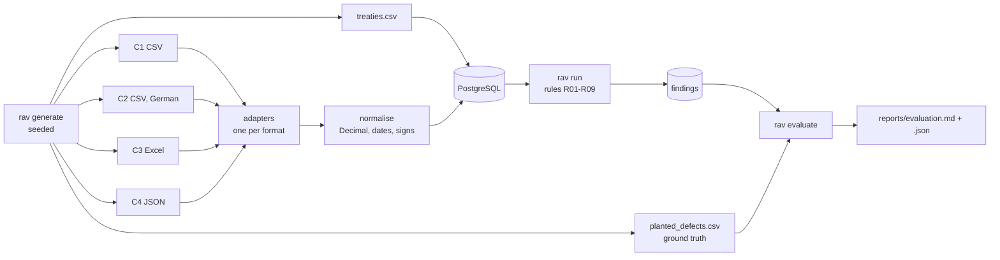

# Architecture

All data in this repository is synthetic.

## Data flow

## Domain terms

- **Cedent**: the insurer that cedes risk and sends the accounts.
- **Treaty**: the reinsurance contract (cedent, currency, term, commission rate, line of business).
- **Technical account**: a cedent's periodic statement for a treaty.
- **Account line**: one row of a technical account (one treaty, one period).
- **Submission**: one file a cedent sent, with many account lines.
- **Finding**: one rule firing on one account line.

The balance is simplified: `balance = premium - commission - claims_paid`. Real technical
accounts have more items.

## Schema (`sql/schema.sql`)

| Table | Purpose |
|---|---|
| `treaties` | Reinsurer master data |
| `submissions` | One row per source file (`source_file` is unique, which makes ingest idempotent) |
| `account_lines` | One row per account line, keyed by `line_ref` |
| `rule_runs` | One row per `rav run`, with `rules_version` (git hash) |
| `findings` | Rule firings: `run_id`, `rule_id`, `line_ref`, `severity`, `message` |

## Design decisions

**No foreign key on `account_lines.treaty_id`.** Defect D06 is a line that references a
treaty that does not exist. With a foreign key the database would reject that line at load
time and the validation rule would never see it. Validation belongs in the rules, where it
is reported, counted and measured.

**Required fields are nullable.** Same reason (D08, missing values). Ingestion never drops
a row; an unparseable value loads as NULL and rule R08 reports it. Only a row without a
`line_ref` is rejected, because it cannot be keyed; that is logged and counted.

**Rules are configuration.** Each rule is a YAML file (id, severity, the defect it
targets, tolerances) validated by pydantic, pointing to a SQL file or a Python function. A
reviewer can read and change a tolerance without touching engine code, and the rule
catalogue in `docs/rules.md` is generated from the same files so it cannot drift.

**SQL where the check is a query, Python where it is not.** R04 (duplicates) keeps the
earliest submission and flags later copies; that is clearer as a few lines of Python than as
a window-function query.

**`Decimal`, never `float`.** Money is `decimal.Decimal` in Python and `NUMERIC(18,2)` in
PostgreSQL. Excel stores numbers as floats, so the Excel adapter converts through `repr` and
rounds to cents.

**Deterministic generator.** One seed gives byte-identical files, including `.xlsx` (zip
timestamps and the workbook modified time are fixed). Defect injection uses its own random
stream derived from the seed, so clean data is identical with and without defects.

**Ground truth by `line_ref`.** Every line carries a stable `line_ref` that survives all
four formats; it is the join key between findings and `planted_defects.csv`. At most one
defect is planted per line so each finding is unambiguous to score.

## Tests

- Unit test per rule: one clean and one violating line; the only finding in the run must be
  the expected rule on the violating line.
- Clean-data test: no defects, all rules, zero findings.
- Re-injection tests per defect type: only that defect planted, the matching rule must flag
  exactly those lines.
- Ingestion round trip: parsed rows equal what the generator wrote, for every format.
- Determinism: same seed, identical file hashes.
